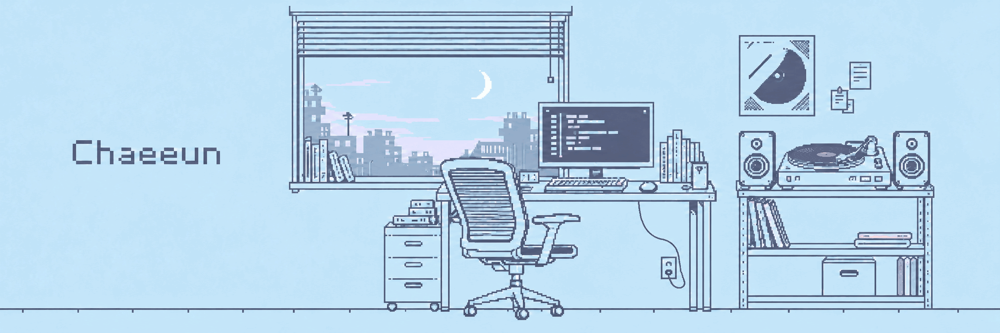

## Hello, Chaeeun here 🍅

I build and ship iOS apps on my own, and usually take the backend in team projects.

📍 Soongsil University, School of Computer Science & Engineering (graduating Feb 2027)

### Tech Stack

**iOS**

**Backend**

**Database · Infra**

**Tools**

### Activity

- 2026.04 ~ · **Uncover Pixels** — solo-built iOS app, released on the App Store (May 2026), still maintained
- 2026.06 ~ 2026.08 · **profAIssor** — backend & LLM integration · Grand Prize, 3rd Soongsil Learning Method Contest (숭실 학습법 경진대회)
- 2025.09 ~ 2025.12 · Learning Community "복학즈" — home server setup & deployment · Best Team
- 2025.06 ~ 2025.11 · **CheckTime** — backend · Encouragement Award, 3rd SSU IT Project Contest
- 2023.10 ~ 2024.02 · INNO-SCHOOL Project+ (9th) · Grand Prize
- 2023.10 · Co-author, *원큐패스 나는야 엔트리 화가* (Darakwon) — Entry coding textbook for kids
- 2022.03 ~ 2023.03 · Python & Scratch instructor, Gguge (꾸그)

### Stats

  
  

